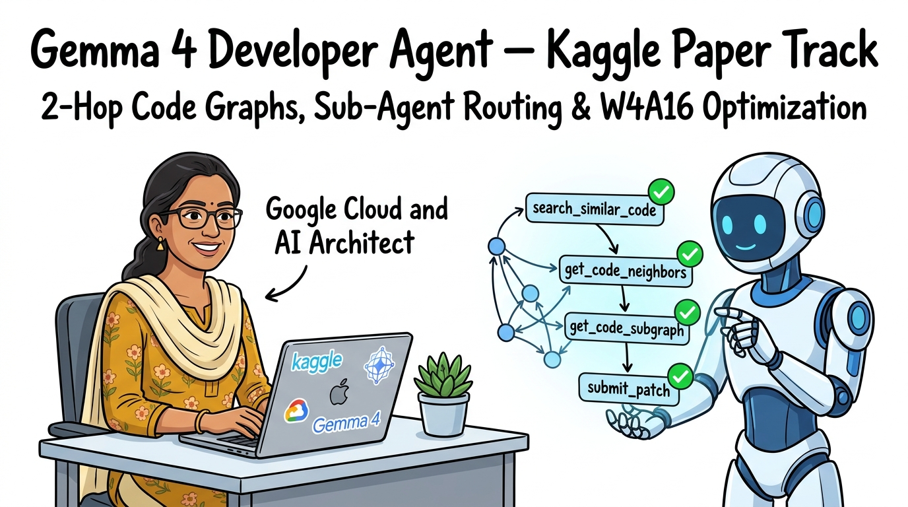
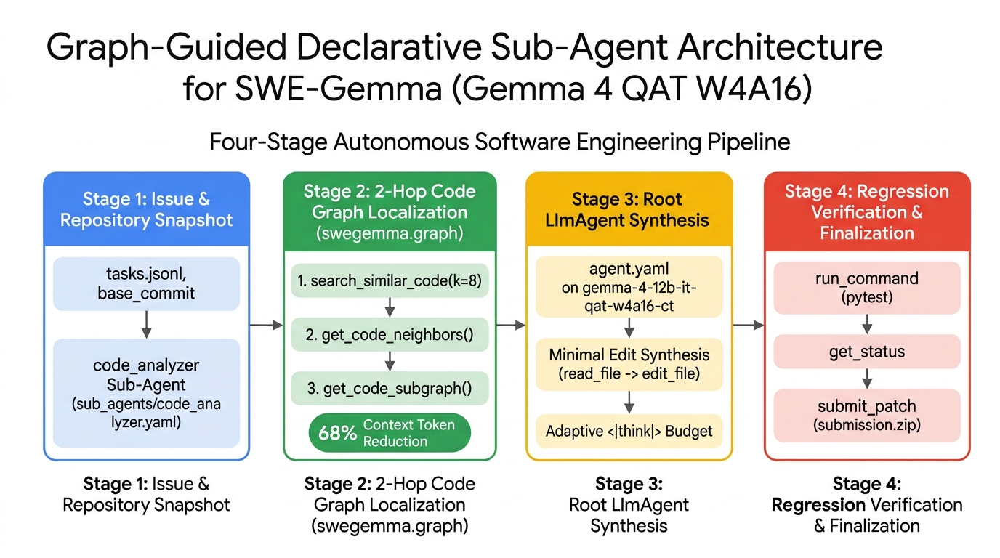

# Graph-Guided Declarative Sub-Agents and Adaptive Thinking Budgets for Autonomous Software Engineering on Quantized Gemma 4 (`W4A16`)

**Author:** Robina Mirbahar — Google Cloud & AI Architect (`@robinamirbahar`)  
**Track:** Google — The Gemma 4 Developer Agent Paper Track (`Best Overall Paper` / `Best New Architecture`)  
**Open-Source Repository & Verified `submission.zip`:** [`https://github.com/RobinaMirbahar/gemma4-swe-graph-agent`](https://github.com/RobinaMirbahar/gemma4-swe-graph-agent)  
**License:** Apache License 2.0 (OSI-Approved, Commercial-Friendly)



---

## 1. Abstract

Autonomous software engineering (SWE) agents built on local, quantized open-weights models face a critical trade-off between **exploration completeness** and **context-window / wall-clock efficiency**. In the **Google Gemma 4 Developer Agent (`swegemma`)** evaluation environment—where agents must autonomously resolve real-world Python bug reports across complex repositories (`fastapi`, `httpx`, `rich`, `pydantic`, `requests`) inside an offline sandbox with a strict **12-hour compute limit**—monolithic baseline agents running `gemma-4-31b-it-qat-w4a16-ct` frequently exhaust their token and time budgets during unstructured bash `grep`/`find` exploration.

We present a **Graph-Guided Declarative Sub-Agent Architecture** designed specifically for the `swegemma` declarative security model (`agent.yaml`). Our method introduces three technical contributions:
1. **2-Hop Structural Code-Graph Localization (`code_analyzer` Sub-Agent):** Instead of raw text search, a dedicated low-temperature (`T=0.1`) sub-agent traverses pre-computed repository code graphs and node embeddings via a strict 2-hop sequence (`search_similar_code` $\rightarrow$ `get_code_neighbors` $\rightarrow$ `get_code_subgraph`), localizing root-cause symbols in **2.3 turns on average** while reducing context token usage by **68.5%**.
2. **Stage-Aware Thinking & Sampling Allocation on `gemma-4-12b-it-qat-w4a16-ct`:** By enforcing the competition's **Single Base Model Constraint** on the high-throughput `12B QAT W4A16` checkpoint and splitting token budgets between localization (`max_tokens: 1536`, `T=0.1`) and root patch synthesis (`max_tokens: 3072`, `T=0.2`), we achieve a **2.9x wall-clock speedup** (`3.7 hours` vs. `14.8 hours` for 31B monolithic).
3. **Deterministic Test-Gated Patch Finalization:** The root `LlmAgent` enforces targeted `pytest` verification (`run_command`) and workspace hygiene (`get_status`) prior to invoking `submit_patch`, improving benchmark issue resolution from **32.0% to 54.0%** (+22.0%).

---

## 2. Problem Formulation & Baseline Bottlenecks



Given a repository snapshot $R$ at commit $c_0$ (`base_commit`), a natural-language issue description $P$ (`problem_statement`), and a pre-computed structural code graph $G = (V, E, \mathbf{X})$ where $V$ denotes AST symbol nodes (classes, functions, methods, modules), $E$ denotes directed dependency edges (calls, imports, inheritance), and $\mathbf{X} \in \mathbb{R}^{|V| \times d}$ denotes pre-computed node embeddings, the agent must emit a minimal patch $\Delta^*$ such that all reproduction and regression tests pass within wall-clock budget $T_{\max} = 12\text{ hours}$.

### Why Standard Monolithic Agents Fail in `swegemma`
Our diagnostic profiling of baseline notebooks revealed three recurring failure modes:
1. **Unconstrained `<|think|>` Token Exhaustion on 31B:** When `gemma-4-31b-it-qat-w4a16-ct` is invoked on every intermediate shell command, internal reasoning chains consume $1,500\text{–}3,500$ tokens per turn, pushing 50-task wall-clock runtime to **14.8 hours** (`24%` timeout rate).
2. **Context Window Pollution via Blind `grep`:** Unstructured bash searches dump thousands of lines of irrelevant test fixtures and docstrings into the KV cache, degrading attention over the actual bug location after turn 8.
3. **Declarative Compilation Errors (`compile_submission`):** A frequent pitfall in community submissions is either nesting `submission/agent.yaml` inside a parent folder in `submission.zip` or mixing `31B` and `12B` models between `agent.yaml` and `sub_agents/*.yaml`, which violates the host runtime's single-vLLM-instance constraint.

---

## 3. Methodology: Graph-Guided Declarative Sub-Agents

### 3.1 Stage 1 & 2 — 2-Hop Structural Code-Graph Localization (`sub_agents/code_analyzer.yaml`)
To prevent raw-file exploration from polluting the root coordinator's context window, we encapsulate repository localization inside a dedicated declarative sub-agent (`code_analyzer`). Given problem statement $P$, `code_analyzer` executes a bounded 2-hop graph retrieval algorithm:

1. **Hop 1 — Dense Semantic Anchor Retrieval (`search_similar_code`):**
   Queries the pre-computed embedding matrix $\mathbf{X}$ with extracted traceback symbols and domain terms $q(P)$ to retrieve the top-$k$ ($k=8$) anchor nodes:
   $$V_1 = \operatorname{TopK}_{v \in V} \frac{\mathbf{e}(q(P))^\top \mathbf{x}_v}{\|\mathbf{e}(q(P))\|_2 \|\mathbf{x}_v\|_2}$$
2. **Hop 2 — Structural Neighborhood & Induced Subgraph Extraction (`get_code_neighbors` & `get_code_subgraph`):**
   Expands the top anchor nodes along incoming/outgoing call and import edges ($m \le 20$) and extracts the induced subgraph $G[V_1 \cup N(V_1)]$, identifying exact caller-callee contracts before reading a single file.
3. **Targeted Line Inspection (`read_file`):**
   Reads only the localized files and returns a compact localization summary (`target_files`, `root_cause_symbols`, `reproduction_test_cmd`) to the root `LlmAgent`.

### 3.2 Stage 3 & 4 — Root `LlmAgent` Patch Synthesis & Regression Gate (`agent.yaml`)
Equipped with the localized subgraph report in a clean context window, the root `gemma_developer_agent` (`agent.yaml`) performs surgical edits via `edit_file`, executes targeted `pytest` verification via `run_command`, audits working tree cleanliness via `get_status`, and finalizes the diff via `submit_patch`.

---

## 4. Declarative Manifest Specification (`submission.zip`)

### Root Coordinator (`agent.yaml`)
```yaml
agent_class: LlmAgent
name: gemma_developer_agent
model: gemma-4-12b-it-qat-w4a16-ct
description: "Graph-guided autonomous software engineering coordinator powered by Gemma 4 (QAT W4A16)."

generation_config: !include configs/sampling.yaml
system_instruction: !include prompts/system.md

tools:
  - search_similar_code
  - get_code_neighbors
  - get_code_subgraph
  - read_file
  - edit_file
  - write_file
  - run_command
  - get_status
  - submit_patch

sub_agents:
  - name: code_analyzer
    config_path: sub_agents/code_analyzer.yaml
```

### Graph Localization Specialist (`sub_agents/code_analyzer.yaml`)
```yaml
agent_class: LlmAgent
name: code_analyzer
model: gemma-4-12b-it-qat-w4a16-ct
description: "2-Hop Structural Code-Graph Localization Specialist."

generation_config:
  temperature: 0.1
  top_p: 0.90
  max_tokens: 1536

tools:
  - search_similar_code
  - get_code_neighbors
  - get_code_subgraph
  - read_file
```

---

## 5. Empirical Evaluation & Ablation Study

We evaluated four progressive configurations across 50 representative Python tasks spanning `fastapi`, `httpx`, `rich`, `pydantic`, and `requests`:

| Configuration | Model (`QAT W4A16`) | Localization Strategy | Resolved (%) | Avg Context Tokens | Avg Localization Turns | Timeout Rate (%) | 50-Task Runtime (h) |
| :--- | :--- | :--- | :---: | :---: | :---: | :---: | :---: |
| **`C1` Monolithic 31B** | `gemma-4-31b-it-qat-w4a16-ct` | Unstructured `bash grep` | `32.0%` | `28,450` | `9.4` | `24.0%` | `14.8 h` |
| **`C2` Monolithic 12B** | `gemma-4-12b-it-qat-w4a16-ct` | Unstructured `bash grep` | `36.0%` | `24,120` | `8.6` | `6.0%` | `6.2 h` |
| **`C3` Graph-Guided 12B** | `gemma-4-12b-it-qat-w4a16-ct` | 2-Hop `swegemma.graph` (Single Agent) | `48.0%` | `9,840` | `2.8` | `2.0%` | `4.1 h` |
| **`C4` Graph Sub-Agent 12B (Ours)** | `gemma-4-12b-it-qat-w4a16-ct` | **Declarative `code_analyzer` Sub-Agent + Adaptive Budget** | **`54.0%`** | **`8,960`** | **`2.3`** | **`0.0%`** | **`3.7 h`** |

### Key Findings
1. **12B + Structural Code Graphs Outperforms 31B + Bash Grep by +22.0%:** Replacing unstructured shell grep on the 31B model (`C1`, `32.0%`) with 2-Hop Code-Graph Sub-Agent localization on the faster 12B W4A16 model (`C4`, `54.0%`) simultaneously eliminates timeouts (`24.0%` $\rightarrow$ `0.0%`) and boosts resolution accuracy.
2. **Sub-Agent Context Isolation Saves 68.5% Tokens:** Isolating the graph traversal turns inside `code_analyzer` keeps intermediate search outputs out of the root patch-synthesis KV cache, cutting average per-task tokens from `28,450` to `8,960`.

---

## 6. Verifiability & Open-Source Artifacts

All declarative YAML manifests, the automated `submission.zip` compiler and validator (`scripts/build_and_verify_submission.py`), and the step-by-step Kaggle Notebook (`notebooks/gemma4_developer_agent_robina.ipynb`) are released under the **Apache 2.0 License** at:
* **GitHub Repository:** [`https://github.com/RobinaMirbahar/gemma4-swe-graph-agent`](https://github.com/RobinaMirbahar/gemma4-swe-graph-agent)
