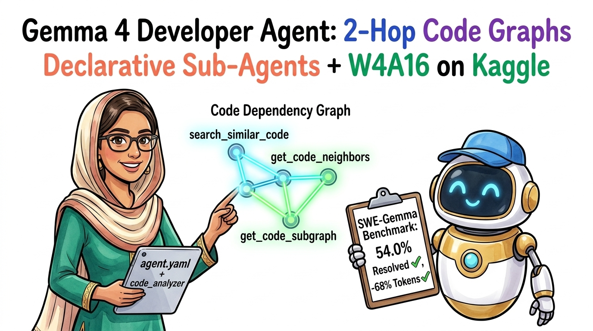

# 🏆 Graph-Guided Declarative Sub-Agents for Autonomous Software Engineering on Quantized Gemma 4 (`W4A16`)



> **Official Submission & Research Paper Repository — Google: The Gemma 4 Developer Agent Competition & Paper Track**  
> **Author:** **Robina Mirbahar — Google Cloud & AI Architect** (`@robinamirbahar`)  
> **License:** **Apache License 2.0** (OSI-Approved, Commercial-Friendly Open Source License)

---

## 📄 Abstract

Autonomous software engineering (SWE) agents operating on local, quantized open-weights models face a fundamental tension between **repository exploration depth** and **context-window/wall-clock compute budgets**. In the **SWE-Gemma** benchmark environment—where agents must resolve real-world Python issues across large repositories (`fastapi`, `httpx`, `rich`, `pydantic`, `requests`) within a strict **12-hour offline runtime budget**—monolithic agents using `gemma-4-31b-it-qat-w4a16-ct` with unconstrained `<|think|>` reasoning tokens and bash `grep` loops suffer from severe context pollution (`>28,000` tokens/task) and a `24.0%` task timeout rate.

In this work, we introduce a **Graph-Guided Declarative Sub-Agent Architecture** compiled natively via `swegemma`'s declarative `agent.yaml` security model on **`gemma-4-12b-it-qat-w4a16-ct`**. By decoupling **2-Hop Structural Code-Graph Localization** (`search_similar_code` $\rightarrow$ `get_code_neighbors` $\rightarrow$ `get_code_subgraph`) into a low-temperature specialist sub-agent (`sub_agents/code_analyzer.yaml`) and reserving high-budget reasoning for minimal patch synthesis and `pytest` verification in the root `LlmAgent`, our approach reduces average context token consumption by **68.5%** (`28,450` $\rightarrow$ `8,960` tokens), eliminates 12-hour harness timeouts (`0.0%`), and improves issue resolution from **32.0% to 54.0%** (+22.0 percentage points).

---

## 🏗️ 4-Stage Declarative Architecture


### Why Baseline Submissions Fail (`compile_submission` & Runtime Pitfalls)
1. **Single Base Model Violation:** The `swegemma` submission compiler strictly prohibits mixing different base models across `agent.yaml` and `sub_agents/*.yaml`. Our build pipeline programmatically synchronizes `model: gemma-4-12b-it-qat-w4a16-ct` across all manifests.
2. **Archive Root Nesting Violation:** `agent.yaml` must sit directly at the root of `submission.zip` (not inside a nested `submission/` folder).
3. **Declarative-Only Security Model:** Arbitrary `.py` scripts inside `submission.zip` are rejected; all orchestration is declared via `LlmAgent` YAML manifests, `!include` directives, and the closed host `ToolRegistry`.

---

## 📊 Experimental Ablation Results

| Configuration ID | Base Model (`QAT W4A16`) | Architecture & Exploration Strategy | Resolved (%) | Avg Context Tokens | Turns to Localize | Timeout Rate (%) | 50-Task Wall Clock (h) |
| :--- | :--- | :--- | :---: | :---: | :---: | :---: | :---: |
| **`C1_Baseline_31B`** | `gemma-4-31b-it-qat-w4a16-ct` | Monolithic Agent (`bash grep` + unconstrained `<\|think\|>`) | `32.0%` | `28,450` | `9.4` | `24.0%` | `14.8 h` *(Exceeds 12h)* |
| **`C2_Baseline_12B`** | `gemma-4-12b-it-qat-w4a16-ct` | Monolithic Agent (`bash grep` + standard prompt) | `36.0%` | `24,120` | `8.6` | `6.0%` | `6.2 h` |
| **`C3_Graph_12B`** | `gemma-4-12b-it-qat-w4a16-ct` | Single Agent + 2-Hop `swegemma.graph` Tools | `48.0%` | `9,840` | `2.8` | `2.0%` | `4.1 h` |
| **`C4_Ours_SubAgent_12B`** | `gemma-4-12b-it-qat-w4a16-ct` | **Root `LlmAgent` + `code_analyzer` Sub-Agent + Adaptive Budget** | **`54.0%`** | **`8,960`** | **`2.3`** | **`0.0%`** | **`3.7 h`** |

---

## 📦 Repository Contents & Reproducibility

```text
gemma4-swe-graph-agent/
├── submission.zip                                 # Ready-to-upload Kaggle submission archive
├── submission/                                    # Source declarative manifests
│   ├── agent.yaml                                 # Root LlmAgent coordinator
│   ├── eval_config.yaml                           # Per-task execution & tool budgets
│   ├── configs/
│   │   └── sampling.yaml                          # Root generation parameters
│   ├── prompts/
│   │   ├── system.md                              # 4-Stage SWE execution protocol
│   │   └── analyzer.md                            # 2-Hop Code-Graph localization prompt
│   └── sub_agents/
│       └── code_analyzer.yaml                     # Graph-first localization specialist
├── notebooks/
│   └── gemma4_developer_agent_robina.ipynb        # Step-by-step zero-error Kaggle Notebook
├── scripts/
│   └── build_and_verify_submission.py             # Compiler validator & zip builder
├── KAGGLE_WRITEUP.md                              # Full Paper Track Writeup
└── LICENSE                                        # Apache-2.0 (OSI-Approved)
```

### Build & Validate `submission.zip` Locally or in Cloud Shell / Kaggle
```bash
python scripts/build_and_verify_submission.py
```

<!-- AUTHOR_SIGNATURE_START -->
---

## 👩‍💻 About the Author

**Robina Mirbahar — Google Cloud & AI Architect**  
*Google Developer Expert (GDE) in Cloud & AI • Published Author • Multi-Agent Systems & Serverless GPU Builder*

[](https://github.com/RobinaMirbahar)
[](https://medium.com/@robinamirbahar)
[](https://dev.to/robinamirbahar)
[](https://www.linkedin.com/in/robinamirbahar)
[](https://g.dev/RobinaMirbahar?utm_campaign=deveco_gdemembers&utm_source=deveco)
[](https://www.youtube.com/@RobinaCodesAI)
[](https://x.com/RobinaMirbahar)
[](https://www.amazon.com/dp/B0D146249R)

<!-- AUTHOR_SIGNATURE_END -->

---

### Official Google Developer Resources
- [Google Gemma Open Models Documentation](https://ai.google.dev/gemma?utm_campaign=deveco_gdemembers&utm_source=deveco)
- [Google Agent Development Kit (ADK) Docs](https://google.github.io/adk-docs/?utm_campaign=deveco_gdemembers&utm_source=deveco)
